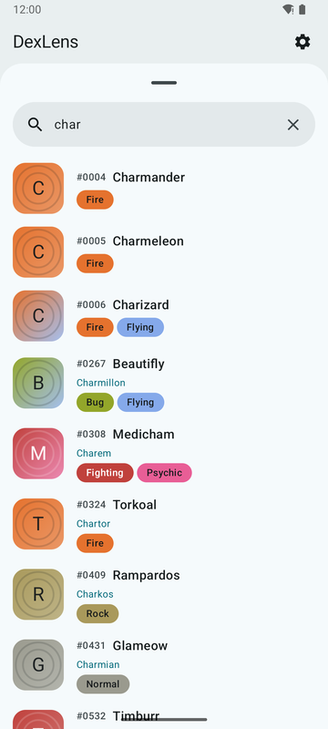
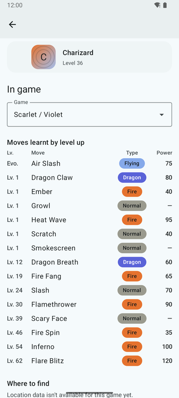

# DexLens

DexLens is an open-source, offline-first Pokémon reference for Android. All 1,025 species ship inside the app, so
browsing, searching and reading an entry work in airplane mode from the first launch. Point the camera at a Pokémon RPG,
from Game Boy to Switch, and it recognises the Pokémon from its name on the screen or from its sprite, then lists it on
the home screen.

**[Download the latest APK from GitHub Releases](https://github.com/arthurnagy/DexLens/releases/latest)**:
`app-arm64-v8a-release.apk` for almost every phone from the last several years, or `app-universal-release.apk`, about
twice the size, if that one doesn't install.

| Scan and browse | Search | Entry | In game |
| --- | --- | --- | --- |
|  |  |  |  |

## Features

- **All 1,025 species, offline.** Pokédex number, names in every language, genus, types, height, weight, base stats,
  abilities including hidden ones, evolution line with triggers, egg groups, gender ratio and forms.
- **Search as you type.** Prefix search that ignores case, accents and punctuation (`flabebe`, `mr mime`, `farfetchd`),
  Pokédex numbers (`25`, `#025`) and names in other languages.
- **Type matchups.** Weaknesses, resistances and immunities computed on the device from the type chart.
- **In game.** Pick a game pair, such as Sword / Shield, to see the moves learnt by level up and where to find the
  Pokémon in the wild. The last game picked is remembered. PokeAPI has no wild locations for games after Sword / Shield yet.
- **Camera recognition.** The scanner sits on the home screen above the list and reads the aiming box two ways at once:
  bundled text recognition reads the Pokémon's name, tolerating common misreads, and a bundled image model recognises the
  Pokémon from its sprite. A name counts for more than the picture. A name locks after three of the last five frames, a
  name and an agreeing picture after two, and a picture alone only with a high score in four of five frames. The picture
  also settles names the text can't tell apart, such as "NIDORAN" without its symbol. It names the species, not the form.
  It can be turned off in Settings. No connection needed.
- **Optional artwork and Pokédex text.** A one-time, resumable download. The newest Pokédex text becomes the entry's
  short description. Without it, type-tinted placeholders are used and everything else works the same.
- **Adaptive.** Phone, tablet and foldable, with a list-detail layout, shared-element transition, predictive back,
  dark theme, edge-to-edge drawing and TalkBack labels.
- **Quick to start and scroll.** The release build is shrunk and optimized with R8 and ships Baseline and startup
  profiles, so startup and list scrolling run precompiled code from the first launch, including on APKs installed
  from GitHub. A splash screen shows the app icon until the saved theme is loaded.

## Privacy

DexLens has no accounts, ads, analytics or crash reporting.

- **Network.** The only network use is the optional download, and only after you start it. It contacts one host,
  `raw.githubusercontent.com`. The app's HTTP client refuses every other host and does not follow redirects.
- **Camera.** Once you allow it, the camera starts when the app opens and runs only while the scanner area is on screen.
  Frames are processed on the device by the two models bundled in the APK. The image model runs on LiteRT, which is
  bundled too rather than loaded through Google Play services. Nothing is stored or sent. Turn off "Scanner on home
  screen" in Settings and the camera never starts and DexLens doesn't ask for access.
- **ML Kit usage data.** Google documents that
  [ML Kit collects device and app information, per-installation identifiers and usage metrics](https://developers.google.com/ml-kit/android-data-disclosure)
  and sends them over HTTPS. DexLens removes the `datatransport` components that perform that upload, so the data is
  never sent. ML Kit's own log confirms it at runtime: `Transport backend 'cct' is not registered`.
- **Measured result.** On a Pixel 6 (Android 17 beta) with Wi-Fi on, using the list, search, entries and the camera on a
  fresh install, Android's per-app traffic counter recorded no bytes for DexLens. This was measured before image
  recognition was added.
- **Backups.** Android Auto Backup and device-to-device transfer are turned off.

## Architecture

Kotlin, Jetpack Compose and Material 3, on the [android-forge](https://github.com/arthurnagy/android-forge) stack.

```
:app                     composition root, Nav 3 back stack, list-detail scene
:feature:pokedex         home screen: list, search, CameraX preview, ML Kit text and LiteRT image recognition
:feature:entry           full species entry
:feature:settings        optional download, scanner switch, theme, credits
:core:domain             use cases, repository interfaces, name matcher, picture matching, lock-on tracker
:core:data               repositories, downloader, WorkManager worker
:core:database           Room 3: prebuilt Pokédex with FTS5 search, and a writable database for downloaded text
:core:network            HTTP client limited to the download host
:core:datastore          preferences
:core:model              plain Kotlin models
:core:navigation         navigator shared by the features
:core:ui, :core:designsystem   shared composables and tokens
:core:testing            fakes and test data
:benchmarks              Baseline Profile generator and Macrobenchmarks (run on a device)
```

Features see only `:core:domain` and shared UI. Decisions are recorded in [docs/DECISIONS](docs/DECISIONS), and behavior
specs live in [openspec/specs](openspec/specs).

The prebuilt database is generated from Room's exported schema by [`tools/build_database.py`](tools/build_database.py),
from a pinned PokeAPI commit, so the file always passes Room's validation. It holds no game art and no game flavor text.

## Build

Requires JDK 21, Android SDK 37 and a device or emulator on Android 10 or later. The JDK 17 toolchain the modules
compile with is downloaded by Gradle if it's missing.

```bash
./gradlew assembleDebug                      # debug APK
./gradlew unitTests                          # local tests
./gradlew spotlessCheck lint coverageVerify assembleDebug -Proborazzi.test.verify=true   # the CI gate
./gradlew recordRoborazziDebug               # re-record screenshot goldens
./gradlew :app:assembleRelease               # minified release APK, unsigned unless signing is set up
```

Pull requests run the gate and a release build, so a class R8 removes or renames shows up before merging.

To refresh the Baseline and startup profiles after a change to startup or the main screens, connect a device or
start an emulator (Android 10 or later), then commit the regenerated files in
`app/src/release/generated/baselineProfiles/`:

```bash
./gradlew :app:generateReleaseBaselineProfile          # records the profiles on the connected device
./gradlew :benchmarks:connectedBenchmarkReleaseAndroidTest   # startup and scrolling, with and without profiles
```

To regenerate the bundled database after a schema or data change:

```bash
./gradlew :core:database:kspDebugKotlin      # refreshes core/database/schemas
python3 tools/build_database.py              # fetches PokeAPI and writes the database asset
```

## Releasing

1. Bump `versionName` and `versionCode` in `app/build.gradle.kts` in a `chore(release): vX.Y.Z` pull request.
   `git cliff --bumped-version` suggests the next version from the commit messages.
2. Once it's merged, tag that commit and push the tag:
   `git tag -a vX.Y.Z -m "Release vX.Y.Z" && git push origin vX.Y.Z`.

The tag runs `.github/workflows/release.yml`. It stops if the tag doesn't match `versionName` or a signing secret is
missing. Otherwise it builds and signs the app and creates a GitHub Release with these files and release notes written
by git-cliff from the commit messages:

| File | What |
| --- | --- |
| `app-release.aab` | The bundle for Google Play |
| `app-arm64-v8a-release.apk` | The APK for 64-bit ARM phones, about half the size of the universal one |
| `app-universal-release.apk` | The APK for every device |
| `app-mapping.txt` | The R8 mapping, to turn obfuscated stack traces back into readable ones |

Running the workflow by hand from the Actions tab is a dry run: it builds and signs everything and keeps the files as a
workflow artifact, but publishes no Release.

Signing uses an upload key, provided through these repository secrets:

| Secret | Value |
| --- | --- |
| `ANDROID_KEYSTORE_BASE64` | Your keystore, base64-encoded: `base64 -i release.keystore \| pbcopy` |
| `ANDROID_KEYSTORE_PASSWORD` | The keystore password |
| `ANDROID_KEY_ALIAS` | The key alias |
| `ANDROID_KEY_PASSWORD` | The key password |

## Credits

Pokémon data, artwork and flavor text come from [PokeAPI](https://pokeapi.co/)
([BSD-3-Clause](https://github.com/PokeAPI/pokeapi/blob/master/LICENSE.md)). Artwork and text are downloaded directly from
PokeAPI's public repositories and are never part of this repository or the APK. Text recognition uses
[ML Kit](https://developers.google.com/ml-kit), and image recognition runs a MobileNetV4 model on
[LiteRT](https://ai.google.dev/edge/litert).

DexLens is released under the [MIT License](LICENSE).

Unofficial fan project, not affiliated with or endorsed by Nintendo, Game Freak or The Pokémon Company. Pokémon names are
trademarks of their owners. No game artwork is bundled with the app. The image model and its reference file hold numbers
derived from pictures, not pictures.
