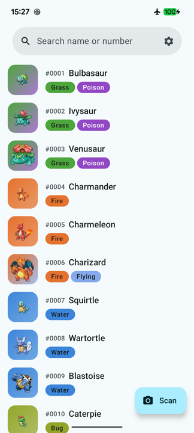
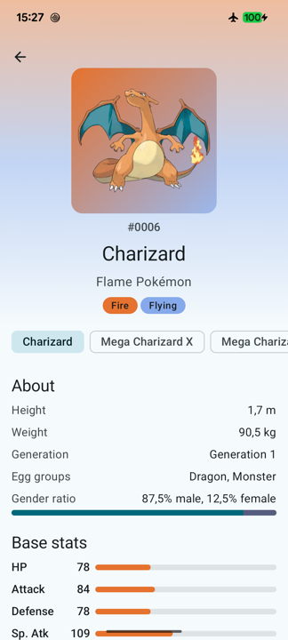
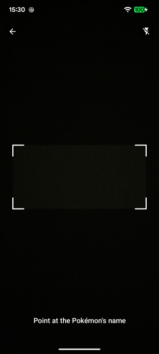

# DexLens

DexLens is an open-source, offline-first Pokémon reference for Android. All 1,025 species ship inside the app, so
browsing, searching and reading an entry work in airplane mode from the first launch. Point the camera at a Pokémon RPG,
from Game Boy to Switch, and it reads the name on the screen and opens the entry.

**[Download the latest APK from GitHub Releases](https://github.com/arthurnagy/DexLens/releases/latest)**

| Browse | Entry | Scan |
| --- | --- | --- |
|  |  |  |

## Features

- **All 1,025 species, offline.** Pokédex number, names in every language, genus, types, height, weight, base stats,
  abilities including hidden ones, evolution line with triggers, egg groups, gender ratio and forms.
- **Search as you type.** Prefix search that ignores case, accents and punctuation (`flabebe`, `mr mime`, `farfetchd`),
  Pokédex numbers (`25`, `#025`) and names in other languages.
- **Type matchups.** Weaknesses, resistances and immunities computed on the device from the type chart.
- **Camera name recognition.** Bundled text recognition reads the name inside an aiming box, tolerates common misreads,
  and locks on only when several frames agree. No connection needed.
- **Optional artwork and Pokédex text.** A one-time, resumable download. Without it, type-tinted placeholders are used
  and everything else works the same.
- **Adaptive.** Phone, tablet and foldable, with a list-detail layout, shared-element transition, predictive back,
  dark theme, edge-to-edge drawing and TalkBack labels.

## Privacy

DexLens has no accounts, ads, analytics or crash reporting.

- **Network.** The only network use is the optional download, and only after you start it. It contacts one host,
  `raw.githubusercontent.com`. The app's HTTP client refuses every other host and does not follow redirects.
- **Camera.** Frames are processed on the device by a model bundled in the APK. Nothing is stored or sent.
- **ML Kit usage data.** Google documents that
  [ML Kit collects device and app information, per-installation identifiers and usage metrics](https://developers.google.com/ml-kit/android-data-disclosure)
  and sends them over HTTPS. DexLens removes the `datatransport` components that perform that upload, so the data is
  never sent. ML Kit's own log confirms it at runtime: `Transport backend 'cct' is not registered`.
- **Measured result.** On a Pixel 6 (Android 17 beta) with Wi-Fi on, using the list, search, entries and the camera on a
  fresh install, Android's per-app traffic counter recorded no bytes for DexLens.
- **Backups.** Android Auto Backup and device-to-device transfer are turned off.

## Architecture

Kotlin, Jetpack Compose and Material 3, on the [android-forge](https://github.com/arthurnagy/android-forge) stack.

```
:app                     composition root, Nav 3 back stack, list-detail scene
:feature:pokedex         home list and search
:feature:entry           full species entry
:feature:scanner         CameraX preview, ML Kit recognition, result sheet
:feature:settings        optional download, theme, credits
:core:domain             use cases, repository interfaces, name matcher, lock-on tracker
:core:data               repositories, downloader, WorkManager worker
:core:database           Room 3: prebuilt Pokédex with FTS5 search, and a writable database for downloaded text
:core:network            HTTP client limited to the download host
:core:datastore          preferences
:core:model              plain Kotlin models
:core:ui, :core:designsystem   shared composables and tokens
```

Features see only `:core:domain` and shared UI. Decisions are recorded in [docs/DECISIONS](docs/DECISIONS), and behavior
specs live in [openspec/specs](openspec/specs).

The prebuilt database is generated from Room's exported schema by [`tools/build_database.py`](tools/build_database.py),
from a pinned PokeAPI commit, so the file always passes Room's validation. It holds no game art and no game flavor text.

## Build

Requires JDK 17 or later, Android SDK 37 and a device or emulator on Android 10 or later.

```bash
./gradlew assembleDebug                      # debug APK
./gradlew unitTests                          # local tests
./gradlew spotlessCheck lint coverageVerify assembleDebug -Proborazzi.test.verify=true   # the CI gate
./gradlew recordRoborazziDebug               # re-record screenshot goldens
```

To regenerate the bundled database after a schema or data change:

```bash
./gradlew :core:database:kspDebugKotlin      # refreshes core/database/schemas
python3 tools/build_database.py              # fetches PokeAPI and writes the database asset
```

## Releasing

Pushing a `v*` tag runs `.github/workflows/release.yml`, which builds a signed APK and AAB and attaches them to a GitHub
Release. Add these repository secrets first:

| Secret | Value |
| --- | --- |
| `ANDROID_KEYSTORE_BASE64` | Your keystore, base64-encoded: `base64 -i release.keystore \| pbcopy` |
| `ANDROID_KEYSTORE_PASSWORD` | The keystore password |
| `ANDROID_KEY_ALIAS` | The key alias |
| `ANDROID_KEY_PASSWORD` | The key password |

## Credits

Pokémon data, sprites and flavor text come from [PokeAPI](https://pokeapi.co/)
([BSD-3-Clause](https://github.com/PokeAPI/pokeapi/blob/master/LICENSE.md)). Sprites and text are downloaded directly from
PokeAPI's public repositories and are never part of this repository or the APK. Text recognition uses
[ML Kit](https://developers.google.com/ml-kit).

DexLens is released under the [MIT License](LICENSE).

Unofficial fan project, not affiliated with or endorsed by Nintendo, Game Freak or The Pokémon Company. Pokémon names are
trademarks of their owners. No game artwork is bundled with the app.
